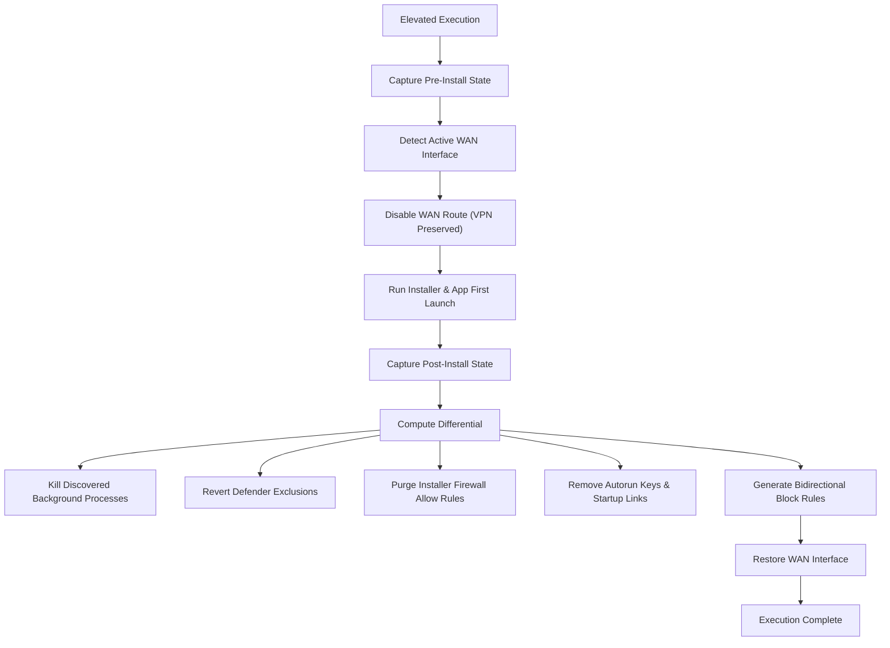

# windows-app-isolation

PowerShell toolkit for offline installation auditing, forensic diffing, and firewall containment on Windows.

It severs external network routes during installations, diffs system state to detect dropped binaries and unauthorized persistence, and generates bidirectional Windows Defender Firewall rules for every discovered component.

---

## Threat Model & Mechanisms

Installers for untrusted, modified, or telemetry-heavy software often introduce secondary persistence or system modifications:

- **Antivirus Tampering**: Silently registering paths in Windows Defender exclusions via `Add-MpPreference -ExclusionPath`.
- **Stealth Firewall Rules**: Adding inbound or outbound `Allow` rules during setup.
- **Out-of-Tree Droppers**: Writing auxiliary executables into `%TEMP%`, `%APPDATA%`, `%LOCALAPPDATA%`, `%PROGRAMDATA%`, or `C:\Users\Public`.
- **LOLBin Abuse**: Using native Windows binaries (`mshta.exe`, `wscript.exe`, `certutil.exe`, `bitsadmin.exe`) to evade per-binary firewall rules and phone home.
- **Background Telemetry & Services**: Registering unneeded updater services, scheduled tasks, and `Run` / `RunOnce` registry autoruns.

---

## Features

- **Dynamic Adapter Discovery**: Queries default route tables (`0.0.0.0/0`, `::/0`) and network connection profiles to detect active WAN adapters. Disables internet without interrupting local loopbacks or VPN tunnels (Tailscale, WireGuard).
- **Differential Snapshots**: Captures process trees, services, scheduled tasks, registry autoruns, firewall rules, and Defender exclusions before and after execution.
- **Automatic Remediation**: Reverts new Defender exclusions, removes installer-created firewall exceptions, and optionally terminates orphaned background processes.
- **Strict Inbound/Outbound Rules**: Creates bidirectional `Block` rules across Domain, Private, and Public firewall profiles for all target executables, services, and discovered dependencies.
- **LOLBin Containment**: Blocks outbound network traffic for system scripting engines commonly leveraged by infostealers.
- **Portability**: Uses environment variables and dynamic route queries. Works across Windows 10, Windows 11, and Windows Server without hardcoded paths or network aliases.

---

## Toolkit Overview

| Script | Purpose |
| :--- | :--- |
| [`Isolate-App.ps1`](Isolate-App.ps1) | Core engine for offline installs, forensic differential audits, and firewall lockdown. |
| [`Install-AdobeSuite.ps1`](Install-AdobeSuite.ps1) | Automated installer for Adobe packages. Clears trial caches, disables background popup binaries (`ADS`, `CCXProcess`), and isolates all binaries. |
| [`Harden-Network.ps1`](Harden-Network.ps1) | Enforces default inbound firewall blocks, disables LLMNR and NetBIOS over TCP/IP, shuts down CDPSvc, hardens SMB, and locks down OpenSSH. |

---

## Usage

All scripts require an elevated PowerShell terminal. If run unprivileged, they automatically re-launch with a UAC prompt.

### 1. Universal Isolation (`Isolate-App.ps1`)

#### Interactive Menu
```powershell
.\Isolate-App.ps1
```

```text
=====================================================================
   ANTI-STEALER / ANTI-TROJAN OFFLINE INSTALLER & FIREWALL TRAP      
=====================================================================
1. Guided Forensic Offline Install (Auto-cuts Internet, Hunts Droppers & Tampering)
2. Block an Already-Installed App & All Its Dependencies
3. Lock Down Windows LOLBins Against Infostealers (Block mshta, wscript, certutil, etc.)
4. List Currently Blocked Apps / Rules
5. Unblock an App (Remove firewall rules)
Q. Quit
```

#### Automated Install
Runs the target installer while network adapters are down, scans for dropped files, and blocks all identified paths:
```powershell
.\Isolate-App.ps1 -Install -AppName "AppName" -InstallerPath "C:\Path\To\Setup.exe"
```

#### Block Existing App Directory & Services
Scans program directories, services, and tasks matching a keyword and generates blocking rules:
```powershell
.\Isolate-App.ps1 -Block -AppName "TargetVendor"
```

#### Block System LOLBins Outbound
Restricts Windows binaries (`mshta`, `wscript`, `cscript`, `regsvr32`, `rundll32`, `certutil`, `bitsadmin`, `cmd`) from initiating outbound connections:
```powershell
.\Isolate-App.ps1 -LockdownLOLBins
```

#### Remove Isolation Rules
Removes all firewall rules associated with a specific app group:
```powershell
.\Isolate-App.ps1 -Unblock -AppName "AppName"
```

---

### 2. Adobe CC Specialized Installer (`Install-AdobeSuite.ps1`)

Automates offline setup for Adobe applications:
1. Clears residual licensing caches (`SLStore`, `SLCache`, `Adobe PCD`).
2. Disables WAN interfaces.
3. Automatically indexes and runs `Set-up.exe` installers from Desktop or Downloads (or custom path).
4. Terminates and appends `.disabled` to popup binaries (`Adobe Desktop Service.exe`, `CCXProcess.exe`).
5. Disables all associated update services and scheduled tasks (`AGMService`, `AGSService`, etc.).
6. Generates bidirectional firewall block rules for all executables under `Program Files\Adobe`, `Common Files\Adobe`, `ProgramData\Adobe`, and `%APPDATA%`.
7. Re-enables network adapters.

```powershell
# Auto-detect installers in Desktop or Downloads:
.\Install-AdobeSuite.ps1

# Specify installer directory:
.\Install-AdobeSuite.ps1 -InstallerFolder "D:\Installers\Adobe"
```

---

### 3. Network Hardening (`Harden-Network.ps1`)

Applies baseline network security controls:
- **Default Inbound Block**: Sets `DefaultInboundAction = Block` across all profiles (Domain, Private, Public).
- **Disable LLMNR**: Sets `EnableMultiCast = 0` in `HKLM:\SOFTWARE\Policies\Microsoft\Windows NT\DNSClient` to prevent multicast poisoning (Responder).
- **Disable NetBIOS**: Sets `TcpipNetbiosOptions = 2` across all physical adapters.
- **Disable Insecure Inbound Rules**: Turns off open listener rules for Network Discovery (NB-Name, NB-Datagram, UPnP, WSD), DIAL, Proximity, Cast to Device, and Game Bar.
- **Stop CDPSvc**: Shuts down Connected Devices Platform service (closes ports 5040/5050).
- **SMB Hardening**: Enforces SMB packet signing and disables SMBv1.
- **OpenSSH Restriction**: Syncs `~/.ssh/authorized_keys` to `ProgramData\ssh\administrators_authorized_keys` with inheritance disabled and restricts port 22 access to LAN and VPN subnets.

```powershell
.\Harden-Network.ps1
```

---

## Execution Flow



---

## System Requirements

- **OS**: Windows 10, Windows 11, Windows Server 2016+ (x64 / ARM64)
- **PowerShell**: Windows PowerShell 5.1 or PowerShell Core 7+
- **Privileges**: Administrator (for firewall rule creation and network adapter state management)

---

## License

MIT
