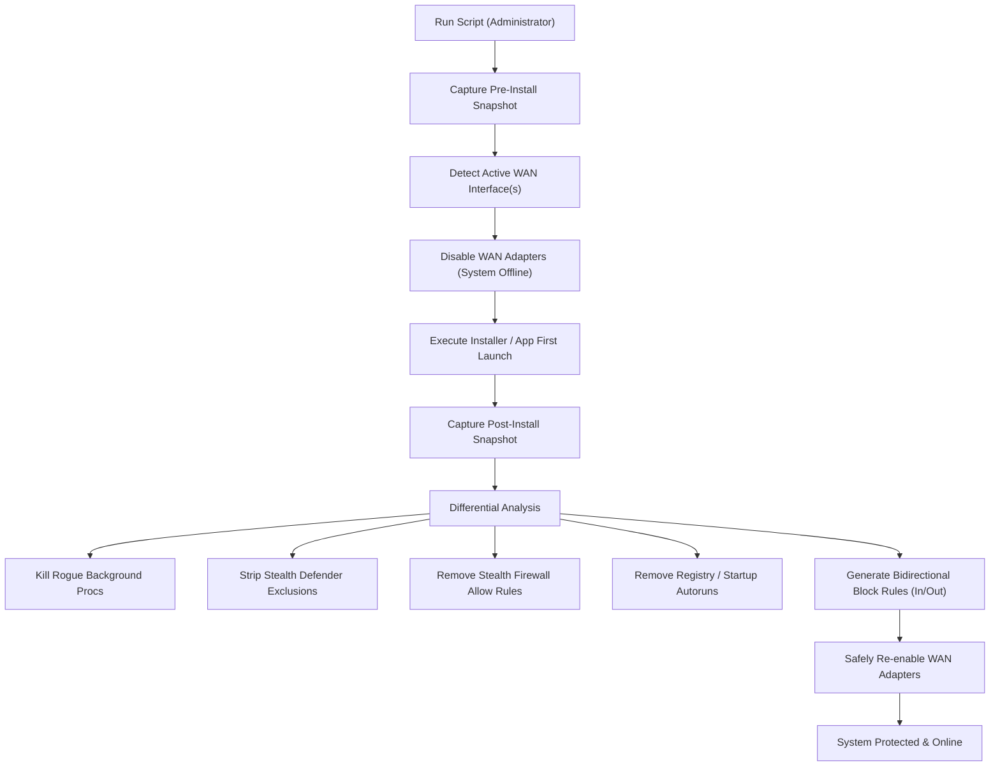

# Windows App Isolation & Anti-Trojan Forensic Lockdown Toolkit

[](https://learn.microsoft.com/en-us/powershell/)
[](https://microsoft.com/windows)
[](LICENSE)

An enterprise-grade PowerShell security and forensic toolkit designed to safely install, isolate, audit, and permanently firewall untrusted, repackaged, or telemetry-heavy software on Windows.

---

## 🛡️ The Threat Model

Untrusted or repacked software installers often include covert threats beyond simple offline operation:
1. **Windows Defender Tampering:** Sneaky installers execute `Add-MpPreference -ExclusionPath` to silently exclude their payload directories from antivirus detection.
2. **Stealth Firewall Whitelisting:** Installers generate their own `ALLOW` rules in Windows Firewall before the user can react.
3. **Hidden Droppers & Infostealers:** Payloads are frequently dropped outside the primary application folder into `%TEMP%`, `%LOCALAPPDATA%`, `%APPDATA%`, `%PROGRAMDATA%`, or `C:\Users\Public` under randomized file and directory names.
4. **Living-Off-The-Land Binary (LOLBin) Abuse:** Infostealers (e.g., RedLine, Vidar, Lumma) invoke legitimate Windows binaries (`mshta.exe`, `wscript.exe`, `certutil.exe`, `bitsadmin.exe`) to bypass application firewall blocks and exfiltrate credentials.
5. **Persistence Mechanisms:** Undesirable background updaters, telemetry services, and Registry `Run`/`RunOnce` keys or Scheduled Tasks.

---

## ⚡ Key Capabilities

- **100% Dynamic & Universal:** Zero hardcoded usernames, system drive letters, or network adapter names (`Ethernet 2`, `Wi-Fi`, etc.). Runs out-of-the-box on any Windows 10/11 machine.
- **Smart WAN Internet Severance:** Dynamically discovers the active default-gateway WAN interfaces using Windows routing tables (`Get-NetRoute 0.0.0.0/0` and `::/0`) and connection profiles. Disables internet while preserving VPNs (Tailscale, WireGuard).
- **Differential Forensic Snapshot Engine:**
  - Takes complete pre-install and post-install snapshots of:
    - Running processes & PIDs
    - System services & service binary paths
    - Scheduled tasks & executed actions
    - Registry Autorun entries (`HKCU`, `HKLM`, `WOW6432Node`, Startup folders)
    - Windows Defender exclusions
    - Windows Firewall rules
  - Diffing pinpoints **every single binary** dropped during the install window.
- **Automatic Tamper Remediation:**
  - Detects and immediately strips unauthorized Defender exclusions.
  - Identifies and removes installer-created firewall `ALLOW` rules.
  - Prompts to terminate rogue background processes spawned by the installer.
  - Reverts malicious or unwanted startup autorun entries.
- **Deep Firewall Lockdown:** Generates bidirectional (`Inbound` AND `Outbound`) Windows Defender Firewall `BLOCK` rules across **all network profiles** (Domain, Private, Public) for every identified application binary, dependency, dropped executable, service, and task.
- **LOLBin Internet Lockdown:** Restricts built-in Windows scripting hosts from direct outbound internet access to prevent script-based data exfiltration.

---

## 📂 Repository Contents

| Script | Purpose |
| :--- | :--- |
| **[`Isolate-App.ps1`](Isolate-App.ps1)** | Universal interactive and command-line engine for forensic offline installation, dropper hunting, and application isolation. |
| **[`Install-AdobeSuite.ps1`](Install-AdobeSuite.ps1)** | Specialized installer for Adobe applications (Photoshop, Illustrator, Premiere Pro, After Effects, Media Encoder, etc.). Disables telemetry popups (`ADS`, `CCXProcess`), cleans trial caches, and enforces complete firewall isolation. |
| **[`Harden-Network.ps1`](Harden-Network.ps1)** | System-wide network hardening: default inbound block, LLMNR and NetBIOS mitigation, SMB hardening, CDPSvc closure, and OpenSSH restriction. |

---

## 🚀 Quick Start & Usage

> [!IMPORTANT]
> All scripts require elevated privileges. If not launched from an elevated prompt, they will automatically prompt for UAC elevation.

### 1. Universal App Isolation (`Isolate-App.ps1`)

#### Interactive Menu Mode
Simply run the script with no parameters to access the full interactive menu:
```powershell
.\Isolate-App.ps1
```

```text
=====================================================================
   ANTI-STEALER / ANTI-TROJAN OFFLINE INSTALLER & FIREWALL TRAP      
=====================================================================
1. Guided Forensic Offline Install (Auto-cuts Internet, Hunts Droppers & Tampering)
2. Block an Already-Installed App & All Its Dependencies
3. Lock Down Windows LOLBins Against Infostealers (Block mshta, wscript, certutil, etc.)
4. List Currently Blocked Apps / Rules
5. Unblock an App (Remove firewall rules)
Q. Quit
```

#### Automated Offline Installation
To automatically isolate an installer via command line:
```powershell
.\Isolate-App.ps1 -Install -AppName "Blender" -InstallerPath "C:\Downloads\installer.exe"
```

#### Block an Already-Installed Application
To find and block all binaries and services belonging to an existing application:
```powershell
.\Isolate-App.ps1 -Block -AppName "Autodesk"
```

#### Lock Down Windows LOLBins
To prevent trojans and infostealers from using Windows system binaries to phone home:
```powershell
.\Isolate-App.ps1 -LockdownLOLBins
```

#### Unblock an Application
To completely remove firewall rules created by this toolkit:
```powershell
.\Isolate-App.ps1 -Unblock -AppName "Blender"
```

---

### 2. Adobe Suite Specialized Installer (`Install-AdobeSuite.ps1`)

Automates the complete installation lifecycle for Adobe CC applications:
1. Cleans stale licensing and trial directories (`SLStore`, `SLCache`, `Adobe PCD`).
2. Takes a forensic baseline snapshot.
3. Automatically searches Desktop and Downloads for Adobe `Set-up.exe` installers (or accepts a target folder).
4. Drops WAN network connectivity.
5. Runs the installer(s) in sequence.
6. Neutralizes `Adobe Desktop Service.exe` (`ADS`) and `CCXProcess.exe` by stopping and disabling their executables (`.disabled`).
7. Disables and blocks all background Adobe update and telemetry services (`AGMService`, `AGSService`, etc.).
8. Blocks every `.exe` in Adobe program directories and common files across all profiles.
9. Restores network connectivity cleanly.

```powershell
# Automatically search Desktop and Downloads:
.\Install-AdobeSuite.ps1

# Or target a specific folder:
.\Install-AdobeSuite.ps1 -InstallerFolder "D:\AdobeInstallers"
```

---

### 3. System Network Hardening (`Harden-Network.ps1`)

Applies critical network baselines to protect your workstation against local network snooping, lateral movement, and unauthorized inbound requests:
- **Default Inbound Block:** Sets `DefaultInboundAction = Block` across Domain, Private, and Public profiles.
- **LLMNR Mitigation:** Disables Link-Local Multicast Name Resolution (UDP 5355) via Registry policy (`EnableMultiCast = 0`) to prevent LLMNR poisoning / Responder attacks.
- **NetBIOS over TCP/IP Mitigation:** Disables NetBIOS across all physical network adapters.
- **Unsolicited Inbound Disabling:** Disables unneeded inbound listening rules (Network Discovery broadcasts, DIAL, Proximity, Cast to Device, UPnP, WSD, Windows Media Player, Feedback Hub).
- **Connected Devices Platform Lockdown:** Stops `CDPSvc` and closes unnecessary local ports (5040/5050).
- **SMB Server Hardening:** Disables legacy SMBv1 and enforces SMB packet signing.
- **OpenSSH Server Hardening:** If OpenSSH (`sshd`) is installed, syncs the current user's `.ssh/authorized_keys` to `administrators_authorized_keys` with strict ACL permissions and restricts inbound SSH (TCP 22) exclusively to LAN and Tailscale subnets.

```powershell
.\Harden-Network.ps1
```

---

## 🔍 How Forensic Hunting Works



---

## ⚙️ Compatibility & Requirements

- **Operating System:** Windows 10, Windows 11, Windows Server 2016+ (x64 / ARM64).
- **Shell:** Windows PowerShell 5.1 or PowerShell Core 7+.
- **Privileges:** Administrator access required for firewall and network adapter manipulation.
- **Network Types:** Compatible with Ethernet, Wi-Fi, Multi-Homed NICs, and Mobile Broadband. Virtual switches (WSL, Hyper-V) and mesh VPNs (Tailscale, WireGuard) are protected from accidental disconnection.

---

## 📄 License

This project is licensed under the [MIT License](LICENSE).
